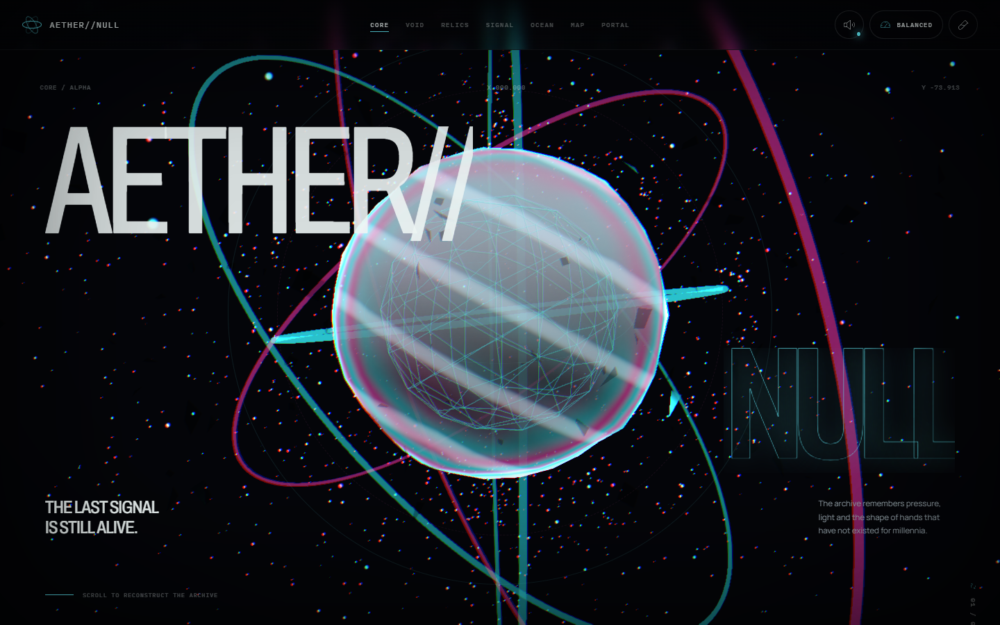

# 公开版体验入口与运行说明

**[打开 AETHER//NULL](https://yangwei251003.github.io/aether-null/)** · [更新记录](CHANGELOG.md) · [本次发布核查](docs/release-validation.md)



这是虚构数字艺术体验，包含程序化3D场景、GLSL材质、交互音频和七章叙事，不采集真实位置、账户、支付或联系人。信号ID是体验内生成的虚构标识。

最简步骤：安装 Node.js 24 与 pnpm 10.33.2，执行 `pnpm install --frozen-lockfile`，再执行 `pnpm dev`。需要发布或预览时执行 `pnpm build` 和 `pnpm preview`。默认英语界面；可使用鼠标、触摸或键盘完成交互。声音只在访客主动进入后尝试解锁，可在HUD关闭；浏览器不支持WebGL时提供2D回退。

**许可范围：** 原创代码与文档使用[MIT](LICENSE)。GSAP不是MIT/OSI开源软件，其许可另见[资产与依赖说明](ASSET_LICENSES.md)；字体、图标、其他依赖保留原声明。不能把整套依赖重新标成MIT。项目AI辅助生成图保留可追溯来源摘要与权利边界。

`.github/workflows/pages.yml` 只上传构建出的 `dist`，不上传依赖缓存、配置或测试诊断。源码与本地字体/图像均随仓库保留。在线部署状态由仓库Actions与Pages实际结果确认。

开发验收需要浏览器：默认先运行 `pnpm exec playwright install chromium`；若本机已有Chrome，可在PowerShell设 `$env:AETHER_BROWSER_CHANNEL='chrome'` 后运行测试。本次使用该官方channel完成验证。

下面为原作品的完整功能、设计和历史验证说明；本次实际检查以发布核查文档为准。

---
# AETHER//NULL — THE LAST SIGNAL

一件运行在浏览器中的实时互动数字艺术作品。体验由 **Boot + 七个连续滚动章节**组成：访客唤醒 Aether Core，穿过载波隧道，检查五件遗物，校准信号场，让记忆海洋升成星图，最后长按开启 Null Gate。隐藏的 Specimen Lab 是独立系统层，可实时改写标本的 shader、材质、力场、主题、时间、粒子预算与后处理。

## 八幕主线

| 幕 | 章节 | 当前实现 |
| ---: | --- | --- |
| 00 | Boot / Cold Start | 等待本地字体、Memory Ocean WebP 和可用时的 3D 模块完成真实任务；预载在 10 秒时释放 Boot。进入时用与 620ms 退场重叠的 580ms 预算解锁 Web Audio，超时或迟到完成都保持静默。 |
| 01 | Core Awakening | 程序化液态 Core、轨道、碎片和粒子随章节进度与细指针观察响应。 |
| 02 | Quantum Descent | shader 粒子隧道、实例化断环、光轨和 SVG 路径共同制造可逆的下坠。 |
| 03 | Relic Vault | 五件不同程序化 3D 遗物与横向 DOM 展馆；选中物在实时场景中推进并居中，其余遗物退让，再由共享元素 View Transition 双向衔接 3D 展台与 2D 详情。 |
| 04 | Signal Lab | 调整 Frequency、Coherence、Entropy；达到阈值并保持 1.4 秒后生成 `AETH-XXXX-XXXX` Signal ID。 |
| 05 | Memory Ocean | 本地 AVIF/WebP 主视觉、指针涟漪、3D 海面与粒子海→星变形。 |
| 06 | Constellation | 30 个实例节点、32 条脉冲连线和 6 个主节点；桌面可拖拽空间场，所有设备可用 DOM 按钮聚焦主节点。 |
| 07 | Null Gate | 鼠标、触摸或 Space/Enter 持续按住约 1.7 秒完成充能，随后进入 2.2 秒 crossing；光、粒子、曝光与相机 dolly/FOV/shake 同步推进。完成构图只在 Portal 为当前幕时固定于安全区域，结果按钮还会等待完成指针释放并保护 180ms。 |

Specimen Lab 在内容配置中登记为隐藏的 Act 08，但不占主线滚动长度。它可从桌面/平板 HUD 打开，也可在 Portal 完成后从任意设备进入。

## 运行与构建

需要 Node.js `^20.19.0` 或 `>=22.12.0`；项目锁定 `pnpm@10.33.2`。

```bash
pnpm install --frozen-lockfile
pnpm dev
```

开发服务器监听所有本机网络接口，终端会显示实际地址。生产构建与预览：

```bash
pnpm build
pnpm preview
```

Vite 将生产文件写入 `dist/`。开源发布版使用相对base，动态图片路径统一读取 `import.meta.env.BASE_URL`，支持GitHub Pages仓库子路径；不要直接用file://打开构建文件。

## 验证命令

```bash
pnpm typecheck          # 应用与 Playwright TypeScript
pnpm build              # TypeScript build + Vite production bundle
pnpm test:e2e           # 全部 Playwright 项目
pnpm test:e2e:headed    # 可见 Chromium 调试
pnpm capture            # 三个固定视口的 Awakening 截图
pnpm verify             # typecheck + test:e2e
pnpm licenses:generate  # 按当前生产依赖图重建第三方 inventory/notices
```

Playwright 串行使用真实 Chromium，并由测试服务器先执行生产构建。常规项目为 `desktop 1440×900`、`tablet 1024×1366`、`mobile 390×844`；另有禁用 WebGL/WebGL2 的 fallback 项目。测试覆盖真实 Boot、10 秒预载超时、可中止的迟到 AudioContext 解锁、八幕主线 DOM、WebGL2、三视口构图、reduced-motion 质量恢复、启动 antialias 与运行期 context 稳定性、章节可访问名称、遗物双向共享转场、Signal ID、主星图节点、桌面键盘/触屏 Portal 长按与 2.2 秒 crossing、防 touch-release 点击穿透、Restart、Specimen Lab、GPU buffer 复用、LITE 实际 render submission 预算、Web Audio 不可用、运行时 context loss、2D fallback 及性能/内存预算。主旅程还会断言没有 `console.error`、意外 warning、未捕获 `pageerror`、失败请求、HTTP 4xx/5xx 或远程热链。最终统一 `pnpm verify` 已成功：共收集 46 个测试实例，17 通过、29 按配置跳过、0 失败，耗时 11.3 分钟；`.last-run.json` 为 `passed`。这些 headless 结果不扩大为真机 GPU、完整许可审计或发布保证。

可选的逐幕美术截图默认跳过；旧版审片与最终第三轮证据分别这样运行：

```powershell
$env:AETHER_GALLERY = '1'
pnpm exec playwright test tests/visual-gallery.spec.ts --project=desktop

$env:AETHER_FINAL_GALLERY = '1'
pnpm exec playwright test tests/final-gallery.spec.ts --project=desktop --project=tablet --project=mobile
```

## 已落盘截图与报告

固定视口主截图：

- `output/playwright/desktop.png`
- `output/playwright/tablet.png`
- `output/playwright/mobile.png`

美术审片与实验场截图：

- `output/playwright/round1-boot.png`
- `output/playwright/round1-hero.png`
- `output/playwright/round2-artifacts.png`
- `output/playwright/round2-signal.png`
- `output/playwright/round2-ocean.png`
- `output/playwright/round2-map.png`
- `output/playwright/round2-portal.png`
- `output/playwright/round2-specimen-lab.png`
- `output/playwright/specimen-lab.png`

第三轮最终审片保存在 `screenshots/final-round3/`：desktop 12 帧（Boot、七幕关键状态与 Lab），tablet 7 帧、mobile 7 帧（重排后的 Artifacts、Signal、Ocean、Constellation、Portal ready/open 与 Lab）。真实长按充能与 2.2 秒 crossing 由 Portal 专项测试和运行态覆盖；画廊只保留可重复的 ready/open 稳态，不把软件渲染器的慢截图回读冒充瞬态计时证据。`final-gallery.spec.ts` 在每个项目成功结束时写入同目录的 `manifest.json`，记录视口、reduced-motion、最终质量、真实 WebGL renderer、文件清单与 Console/Network 诊断；该测试由 `AETHER_FINAL_GALLERY=1` 显式启用，不属于默认截图成本。

失败 trace、视频、截图与附件写入 `output/playwright/results/`，HTML 报告写入 `output/playwright/report/`，桌面采样证据写入 `output/playwright/performance-desktop.json`。这些 headless 结果用于回归，不应被当作真机 GPU 承诺；最新测量解释见 `PERFORMANCE.md`。

## 体验控制

- Boot：正常情况下按三个等权预载任务到 `100 / READY`；若仍有任务悬挂，10 秒计时器会显示 fallback 提示并释放入口。点击中心或聚焦后按 Enter/Space，会同时开始固定 620ms 退场与 580ms 音频预算；预算超时时 AbortSignal 中止该次授权并静默进入，之后仍可由 HUD 的新用户手势重新启用。
- 导航：桌面顶部章节导航直接跳幕；窄屏隐藏章节导航，保留品牌、声音、质量和进度。
- Relic Vault：`INSPECT SPECIMEN` 让选中的 3D 遗物推进到镜头中心，并以共享视觉元素 View Transition 打开详情；Escape、背景、关闭或返回按钮反向回到展台。浏览器不支持该 API 或启用 reduced-motion 时使用即时、安全的对话框路径。查看行为会写入本次会话的 discovery 状态，但当前版本没有收集门槛。
- Signal Lab：三个原生 range 控件支持指针与键盘；`AUTO ALIGN` 直达目标。2D 粒子画布中，Shift 或右键将吸引改为排斥。
- Memory Ocean：移动指针改变局部涟漪位置；滚动同时推动 DOM 图像与 3D 海→星变形。
- Constellation：细指针设备可拖拽 3D 场并直接选择节点；六个主节点按钮是键盘、触摸和 fallback 的稳定入口。
- Portal：持续按住主按钮、Space 或 Enter；提前松开会回到 0。1.7 秒充满后进入不可重复触发的 2.2 秒 crossing，完成后的三个结果按钮在原指针仍按住时保持禁用，并从 release 后再保护 180ms，避免触摸落到替换控件；随后 Restart 会重置 Signal、Portal、遗物与节点发现状态，但保留声音、质量和 Lab 设置。
- 声音：首次进入时尝试创建/恢复 Web Audio；HUD 扬声器按钮随时静音或恢复，展开控件可将主音量设为 0–100%。Signal shader 读取 analyser energy；声音关闭时频谱/能量明确归零。
- Specimen Lab：可切换 3 种 shader、3 种材质、3 种力场、4 套主题、3 档质量、`0.25–2×` 时间、`0.25–1.5×` 粒子、`0–1.5×` POST FX 强度、POST FX 总开关和 DEBUG FIELD；粒子密度通过固定最大 buffer 与 drawRange 调整。检测到 SwiftShader 等软件 renderer 时 FPS 指标显示 `SW FPS`，避免把软件帧率当成用户设备成绩。设置在关闭后继续保留于当前页面会话。

## 工程与配置

```text
src/
├─ config/       章节内容、相机、质量、主题、遗物、星图、Signal 与音频配置
├─ scene/        单个 R3F Canvas、七幕实时场景、Lab 标本场、shader 与场景数学
├─ sections/     七个滚动章节的语义 DOM 与主要交互
├─ components/   Boot、HUD、对话框、Fallback、Cursor 与 Specimen Lab 控制台
├─ hooks/        资源预载、WebGL2 探测、Lenis + GSAP/ScrollTrigger 编排
├─ audio/        Web Audio 程序化 drone、滤波、分析和交互瞬态
├─ store/        Zustand 的低频体验、游戏、Portal、Lab 与设置状态
├─ runtime/      指针、滚动、渲染 invalidation 的可变信号桥
├─ types/        配置与运行时状态契约
└─ styles/       全局 token、组件、章节与移动端重构图
```

`src/config/index.ts` 是聚合入口：

| 配置 | 真实职责 |
| --- | --- |
| `content.ts` | `ACTS`、`MAIN_ACTS`、`ACT_BY_ID`、站点元数据、System HUD 品牌与 `SYSTEM_NAVIGATION`。`scrollSpanVh` 目前仍是内容元数据，实际高度由 CSS 与 ScrollTrigger 决定。 |
| `camera.ts` | Boot、七幕与隐藏 Lab 的位置、target、FOV、roll、焦距关键帧。 |
| `quality.ts` | ULTRA/BALANCED/LITE 的 DPR、粒子、几何、阴影、后处理与隔帧更新预算，初始推荐函数，以及 `<900px` 移动质量锁使用的 breakpoint。 |
| `theme.ts` | `CHAPTER_THEMES` 驱动逐幕背景/雾色；`THEME_SCENE_COLORS` 直接派生自 `THEME_VARIANTS`，供 Core 与 Specimen Lab 的实时材质、灯光和场使用。CSS token 仍由样式层维护。 |
| `artifacts.ts` | 五件遗物的文案、几何类型、变换与数据读数。 |
| `constellation.ts` | 30 节点、32 条连接和 6 个主节点语义。 |
| `signal-lab.ts` | 三参数范围、目标、阈值、保持时间与 Signal ID 前缀。 |
| `audio.ts` | drone 场景参数、压缩器、分析器和合成 cue 数据。 |
| `portal.ts` | 1.7 秒充能、2.2 秒 crossing 与相机 dolly/look/FOV/shake 参数。 |
| `features.ts` | 已启用 Artifact View Transition、滚动感知导航、analyser shader 与 adaptive quality；实验 WebGPU、haptics 保持关闭并不影响 WebGL2 主路径。 |

ScrollTrigger 把当前幕和归一化进度写入 runtime signal；CameraRig、shader 和场景对象从 signal/ref/uniform 读取高频数据。React/Zustand 只承载可见 UI 与低频交互状态。SceneCanvas 自身按需动态导入；加载后七个叙事场景驻留在同一个 WebGL2 Canvas 中，`ActLayer` 以 opacity/scale/Z 阻尼交接，退场层可短暂与当前幕重叠，但 `useActFrame` 会立即停止非当前幕的场景更新。运行期切档更新 DPR、场景预算和后处理，不重挂 Canvas；Lab 粒子场一次分配最多 3300 点的 position/phase/scale buffers，密度变化只改 drawRange。Lab 打开时叙事场景组隐藏，独立标本场挂载。

## 质量、自适应与生命周期

| 档位 | 关键预算 |
| --- | --- |
| ULTRA | DPR `1–2`、60 FPS 配置目标、Core/Tunnel `5200/7200` 粒子、shadow manager、0× composer multisampling + SMAA、选择性 Bloom、Noise/Vignette/Chroma，关键幕启用 DOF。 |
| BALANCED | DPR `1–1.5`、60 FPS 配置目标、`2400/3600` 粒子、shadow manager、0× composer multisampling + SMAA、选择性 Bloom、弱 Noise/Vignette/Chroma；当前 composer 不挂载 DOF。 |
| LITE | DPR `0.8–1.15`、约 30 FPS 的真实 demand invalidation 上限、`900/1100` 粒子、关闭 shadow manager/DOF/Chroma/SMAA、0× composer multisampling、0.72 composer scale、重场景隔次 submission 更新。 |

Shadow manager 的开关已接入 Canvas，但当前 scene 没有 `castShadow` / `receiveShadow`，所以没有可见的实时投影。这些 FPS 是预算目标，不是硬件保证。初始 AUTO 规则读取 WebGL2、视口宽度、DPR、`deviceMemory`、`hardwareConcurrency`、粗指针和 reduced-motion：WebGL2 缺失、reduced-motion、宽度 `<900`、粗指针，或浏览器明确报告内存 `≤4 GB` / 核心数 `≤4` 时选 LITE；只有宽度 `>=1440`、DPR `<=2.5` 且两个硬件 API 都明确报告 `>=8` 时选 ULTRA，API 缺失或其他情况为 BALANCED。初始 LITE 会以 antialias=false 创建 Canvas；初始 BALANCED/ULTRA 为 true。此后切档保留同一个 WebGL context，因此桌面从 BALANCED 降到 LITE 时 context AA 仍为 true，移动端以 LITE 启动时则保持 false。独立的后处理 SMAA 可热切换：ULTRA/BALANCED 挂载，LITE 或 POST FX 全局关闭时移除。

进入后先预热 5 秒，再按 6 秒窗口采样：AUTO 下 ULTRA `<60×0.8 = 48 FPS` 降 BALANCED，BALANCED `<60×0.6 = 36 FPS` 降 LITE，LITE `<30×0.67 = 20.1 FPS` 时关闭 POST FX。不会自动升档。没有活动质量锁时，HUD 或 Lab 手动选档会停止这条自动降档链。LITE 把 R3F 切到 demand 并由校正漂移的定时脉冲按约 30 Hz invalidate；页面隐藏或 reduced-motion 同样使用 demand，但停止连续脉冲，只在必要状态变化时请求帧。页面隐藏时 Lenis 与音频也会暂停。

## 移动、可访问性与回退

- `≤1100px` 隐藏章节导航并压缩 HUD；不具备 fine pointer 的中等视口和 `≤767px` 使用原生横向 scroll-snap 遗物轨，手机再采用独立纵向构图、单列 Signal、主节点网格与安全区 Portal。Memory Ocean 外层使用 `overflow: clip` 保持 sticky 海面有效，同时阻止横向溢出。
- `env(safe-area-inset-*)`、`100dvh`、横向裁切和 44px 触控样式用于适配浏览器 UI 与刘海区；移动主旅程目前会检查所有可见 button 的宽高都不小于约 44 CSS px，没有在这条断言中匹配原生 range。手机隐藏 HUD Lab 入口，但 Portal 完成后的 Lab 入口保留。
- `<900px` 或粗指针是实时移动质量锁，不只是初始建议；条件随 resize / pointer media change 更新，锁定时保持 LITE。粗指针还关闭 3D 对象命中并压低配置 path roll。
- `prefers-reduced-motion` 可在运行中生效：Lenis 以即时模式重建，GSAP 非必要时间线关闭，CSS 将循环/转场缩为近乎即时；相机取消指针视差与 roll，Canvas 使用 demand，质量同样锁为 AUTO LITE，Cursor trail 为 0，Signal 2D 场降到 36 粒子并只在进入视口或参数变化时重绘。
- 页面提供 skip link、语义 `main > section`、稳定标题、原生 range/button、可见 focus、live region，以及六个主星图节点的 DOM 等价入口。Canvas 对辅助技术隐藏。
- Artifact Modal 与 Specimen Lab 使用对话框语义、焦点圈定、Escape、背景隔离、页面滚动锁定和关闭后的焦点恢复。
- WebGL2 探测失败、整个 SceneCanvas 被 React error boundary 捕获，或运行中收到 `webglcontextlost` 时，显示按当前幕变化的 CSS 2D Core/隧道/遗物/信号/海面/星图/Portal。Fallback 只替代空间画面；语义叙事、Signal 控件、主节点按钮、Portal 和对话框仍由同一 DOM 路径运行。
- 仍连接 Canvas 的真实 runtime context loss 会被拦截并在当前页面会话永久切到 2D；listener 延后一轮确认目标 Canvas 仍在文档中，已卸载实例的迟到事件不会触发 fallback。当前不尝试恢复/重建 WebGL，也不复制细指针专用的 3D 拖拽/节点命中，因此 fallback 不是第二套等价渲染器。

本地字体的 OFL、Phosphor MIT notice、生产依赖 inventory/包内许可文本与 Memory Ocean 生成来源/文件哈希均记录在 `ASSET_LICENSES.md`，并会随 `public/assets/` 进入生产构建。当前聚合文件归档 72 个生产包、149 份去重 notice；7 个未随包提供顶层 LICENSE/COPYING/NOTICE 的依赖改由嵌入源码声明或 manifest 指定的标准 SPDX 全文补档，未解析记录为 0。GSAP 仍指向实时外部条款，发布方须按实际用途复核；项目自身当前也没有根级 `LICENSE`。创意基准、逐幕实装图和技术记录分别见 `CREATIVE_DIRECTION.md`、`SCENE_MAP.md`、`TECH_PLAN.md`。
